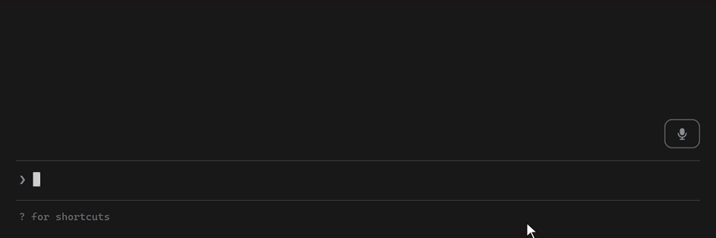

# DictateCLI


> Speak to Claude Code instead of typing.

DictateCLI adds a microphone button to Claude Code, using Claude Code's own native
voice dictation. Click, speak, send.


<sub>Simulated animation of the flow, not a screen recording.</sub>

## What it does

- Adds a microphone button above the prompt. It drives Claude Code's built-in voice dictation.
- Anything you were typing before dictation stays safe and comes back afterward.
- No extra speech service, no extra API key, no audio stored by DictateCLI, no background
  process while idle.
- Follows Claude Code's voice language setting. Change it in `/config` if needed.

It is a small Claude Code plugin with a helper program built on your machine. It has no
speech engine of its own. See [docs/architecture.md](docs/architecture.md).

## Requirements

- Windows. macOS and Linux are not supported in this release.
- Claude Code 2.1.287 or newer, with voice dictation, and a microphone.
- [PowerShell 7](https://learn.microsoft.com/powershell/scripting/install/installing-powershell-on-windows).

The installer checks these first and changes nothing if one is missing.
`pwsh -File scripts\doctor.ps1` tells you if anything is off.

## Install

The installer enables Claude Code's fullscreen mode so the microphone button can
receive clicks. [Uninstall](#uninstall) restores your previous renderer setting.

```powershell
git clone https://github.com/augbastos/dictate-cli
cd dictate-cli
pwsh -File scripts\install.ps1
```

Restart Claude Code. The microphone appears above the prompt.

Installed the plugin another way, for example with `/plugin`? Run `/dictate setup` once
instead, then restart Claude Code; run it again after each plugin update.
`/dictate remove` undoes it.

## Use

| Action | What it does |
|---|---|
| Click the mic button | Start dictating |
| **Send** | Transcribe and send |
| **Cancel** / Esc | Discard the recording |
| Alt+D | Start / send from the keyboard |

## Configuration

- **Shortcut.** The installer takes `-Shortcut alt+d` (default) or `-Shortcut disabled`.
  Other chords can be bound to `command:dictate` in `~/.claude/keybindings.json`
  (context `Chat`). Function keys are refused.
- **Installer switches.** `-Beside` shares the row above the prompt with another plugin's
  card. `-NoFullscreen` leaves the renderer alone (the button is then not clickable;
  `/dictate` still works).
- **Plugin options.** `icon` is `nerd` (default, needs a Nerd Font) or `emoji`. `beside`
  is the same as `-Beside`.
- **Settings page.** `/dictate settings` opens a panel that shows the current shortcut and voice language and where to change each.

## What it runs and sends

- **Programs:** its own helper, `bin\dictate-key.exe` (built from `helper/dictate-key.cs`
  on your machine), to press Claude Code's voice key and read whether Claude Code is using
  the microphone. On `/dictate setup` or `/dictate remove` only, PowerShell 7 runs the
  bundled install or uninstall script.
- **Prompts:** it submits only what Claude Code's voice dictation transcribed, then puts
  your unsent draft back in the prompt. It reads the prompt only to do that.
- **Network:** none of its own. See [SECURITY.md](SECURITY.md) for every file it changes.

## Privacy

DictateCLI itself records nothing, stores nothing, opens no network connection and adds
no telemetry. Your voice is captured and transcribed by Claude Code's built-in voice
dictation, which sends the audio to Anthropic. Details: [PRIVACY.md](PRIVACY.md).

## Compatibility

Tested on Windows, with Claude Code in the VS Code integrated terminal. Other terminals,
such as Windows Terminal, are not yet tested. macOS and Linux are not supported in this
release. Details: [docs/compatibility.md](docs/compatibility.md)

<details>
<summary><strong>Troubleshooting</strong></summary>

- **The mic button does not react.** Clicks need Claude Code's fullscreen mode. The
  installer turns it on; restart Claude Code.
- **Nothing is heard.** Allow the microphone in Windows Settings → Privacy & security
  → Microphone, and check that Claude Code's own `/voice` works.
- **Wrong language.** Set Claude Code's language in `/config`.
- **Alt+D does nothing.** Run the installer again, then restart Claude Code.
- **"Could not reach Claude Code voice."** Run the installer again.
- **Anything else.** Run `pwsh -File scripts\doctor.ps1`; it names what is wrong and
  how to fix it.

</details>

## Uninstall

```powershell
pwsh -File scripts\uninstall.ps1
```

## Layout

| Path | What it is |
|---|---|
| `hooks/` | The plugin code (TypeScript) and its tests |
| `helper/` | The small Windows key helper, built locally into `bin/` |
| `scripts/` | Install, uninstall and doctor scripts |
| `tests/` | Installer tests (PowerShell) |
| `docs/` | Architecture, compatibility and the demo animation |
| `.claude-plugin/` | Plugin manifest and marketplace entry |

## Tests and CI

CI builds the helper, validates the plugin with `claude plugin validate .`, runs
`claude plugin test .`, and runs the installer tests in `tests/`. See
[.github/workflows/ci.yml](.github/workflows/ci.yml).
The offline workflow contract runs first; run it alone with
`pwsh -NoProfile -File tests/ci-workflow.ps1` (Git Bash and jq required).

CI installs a pinned Claude Code version from `.github/ci/package-lock.json`, using
the official Node setup action's npm cache. After validation, plugin tests and the
two installer test modules run in separate processes, on up to three CPU cores.
Run `pwsh -NoProfile -File tests/ci.ps1` on Windows to run the same tests with an
installed Claude Code. CI reports `Safety`, `Lint`, `Test (Windows)`, and `CI passed`.
The required checks are `Safety` and `CI passed`. `Safety` runs on pull requests
using the base revision's policy; `CI passed` requires every job to succeed,
allowing only `Safety` to be skipped outside pull requests.

## More

[Architecture](docs/architecture.md) · [Changelog](CHANGELOG.md) · [Support](SUPPORT.md) ·
[Security](SECURITY.md) · [Terms](TERMS.md) · [Privacy](PRIVACY.md)

## License

MIT. DictateCLI is an independent community plugin, not made or endorsed by Anthropic.
